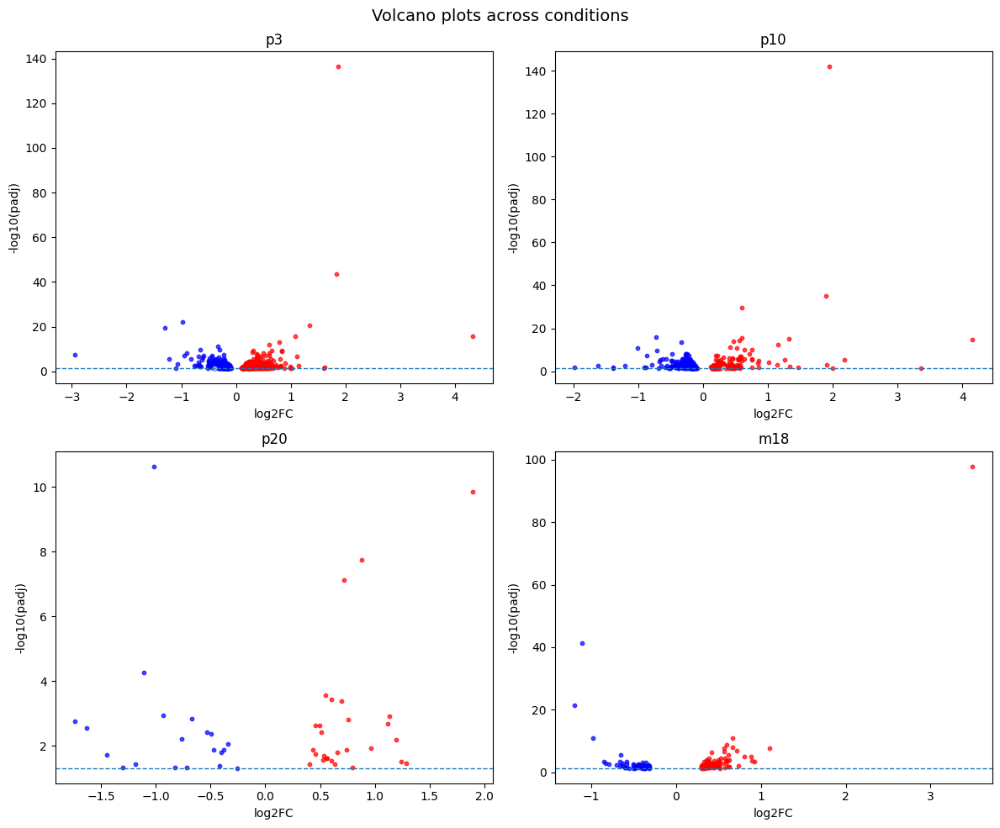
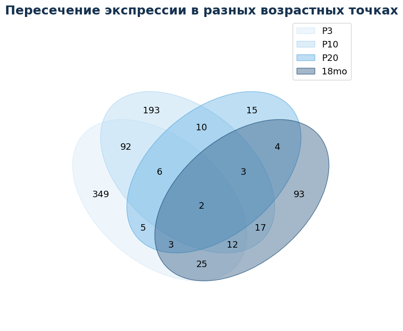
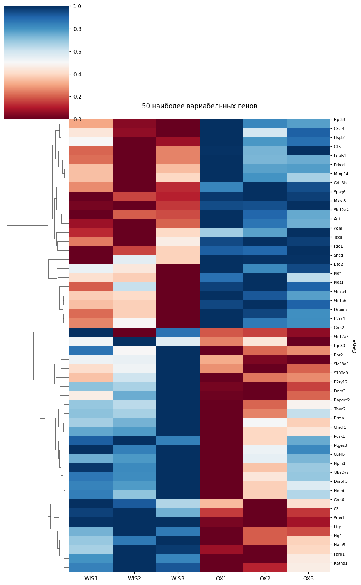

# Transcriptomic analysis of OXYS rat prefrontal cortex

## Overview

This repository contains selected analysis scripts from my bachelor's research project on transcriptomic changes in the prefrontal cortex (PFC) of **OXYS rats**, a model of accelerated senescence and neurodegeneration.

RNA-seq expression profiles were analysed at four ages — postnatal day 3 (**P3**), **P10**, **P20** and **18 months** — and compared with age-matched Wistar rats. The main goal was to find gene expression changes that appear early in development and may be linked to later neurodegenerative changes.

## Research questions

* Which genes are differentially expressed (DEGs) between OXYS and Wistar rats at each age?
* Which genes are consistently altered across several developmental stages?
* Which early-development changes reappear at 18 months?

## Scripts

Differential expression statistics were computed upstream of this repository; the scripts start from the resulting DEG tables and expression matrices.

| Script | What it does | Output |
|---|---|---|
| `scripts/01_extract_target_counts.py` | Extracts expression rows for a gene list (by gene symbol or XLOC id) and optionally attaches gene names | filtered `.xlsx` |
| `scripts/02_deg_summary.py` | Volcano plots and up/down DEG counts per age | `volcano_grid.png`, `deg_counts.png`, `deg_counts.csv` |
| `scripts/03_venn_overlap.py` | Overlap of DEG lists across the four ages | `venn.png`, `deg_membership.csv` |
| `scripts/04_heatmap.py` | log2-transformed, row-scaled clustered heatmaps (all DEGs and top-N most variable genes) | `heatmap_*.png` |

## Example figures

| Volcano plots | DEG overlap |
|---|---|
|  |  |

Heatmap of the 50 most variable DEGs at 18 months (WIS = Wistar, OK = OXYS):



(Figure titles in the example images are in Russian; the scripts produce English labels.)

## Usage

```bash
pip install -r requirements.txt

python scripts/02_deg_summary.py --input data/volcano_data.xlsx --out-dir results
python scripts/03_venn_overlap.py --p3 data/p3_rgd_degs.xlsx --p10 data/p10_rgd_degs.xlsx \
                                  --p20 data/p20_rgd_degs.xlsx --m18 data/18mo_degs_rgd.xlsx
python scripts/04_heatmap.py --input data/18mo_counts_heatmap.xlsx --label 18m --top-n 50
```

Every script has `--help`. Expected inputs:

* **DEG lists**: a table with a `Gene` column (one file per age).
* **DE results** (`02_deg_summary.py`): one workbook, one sheet per age (`p3`, `p10`, `p20`, `m18`), columns `gene`, `log2FC`, `padj`.
* **Heatmap input**: first column = gene name, remaining columns = expression per sample.

## Methods notes

* DEG definition in the plots: adjusted p-value < 0.05, no fold-change threshold.
* Heatmaps: `log2(x + 1)`, then each gene scaled to 0–1 across samples, so colours show relative expression per gene. Samples are kept in their original order.

## Repository structure

```text
scripts/    Analysis scripts
figures/    Example figures generated during analysis
```

## Note

This repository contains selected analysis code from my bachelor's research project. Raw sequencing data and intermediate data tables are not included.

## Tools

Python · pandas · NumPy · seaborn · matplotlib · RNA-seq / differential expression
